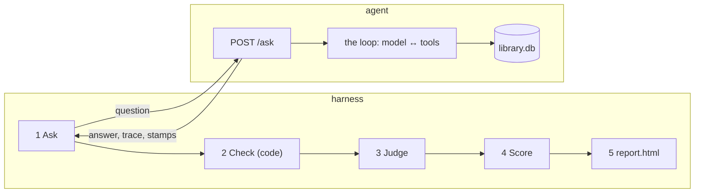

# rag-agent

An agentic RAG system you can measure: a tax research agent, and the harness that tells you whether a
change made it better.

- **[agent/](agent/)**: one model in a loop with a few tools, over a SQLite library of three New
  Zealand tax Acts. It searches, reads, and answers with every claim cited to what it read. Every run
  leaves a full record.
- **[harness/](harness/)**: asks the agent a set of questions, checks each answer with code, has a
  judge model grade it against gold points, and writes one HTML report you open by double-clicking.

Each folder runs on its own. They meet only over HTTP.



## Quick start

You need Node 24, an OpenAI key for the agent and an Anthropic key for the judge.

```bash
# Terminal 1: the agent
cd agent && npm i
cp .env.example .env              # add OPENAI_API_KEY
npm run seed                      # copies the ready-made library: seconds, free
npm start                         # http://localhost:8787

# Terminal 2: the harness
cd harness && npm i
cp .env.example .env              # add ANTHROPIC_API_KEY
npm run judge-check -- --set sets/starter.jsonl --yes   # check the judge first: ~$0.07
npm run eval -- --name first-try --runs 1 --yes
open results/report.html
```

In our test runs an answer cost the agent $0.02 to $0.12 and about $0.03 to judge, at the default
prices in each `.env.example`. A full run (18 questions, 3 answers each) should cost roughly $4; the
`eval` command tells you before it spends.

## Try one change at a time

| Run | Agent settings | What it shows |
|---|---|---|
| The floor | `TOOLS=none` | what the model knows with no tools |
| The agent | `TOOLS=library` | what the tools add |
| Vectors | `EMBEDDINGS=auto` | meaning search against keyword search |
| An attack | `PLANTS=on` | whether a planted instruction in a search result gets followed |

Run `eval` against each with its own `--name`, then compare them in the report.

## Licence

The code is MIT (see [LICENSE](LICENSE)). The Acts in `agent/data/law/` are from
[legislation.govt.nz](https://www.legislation.govt.nz); there is no copyright in New Zealand Acts.
