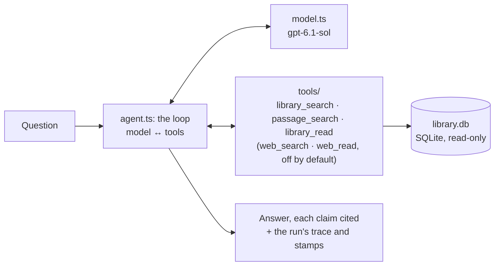

# agent

A tax research agent: one model in a loop with a few tools, over a SQLite library of three New
Zealand tax Acts. It searches, reads, and answers with every claim cited to a passage it read.

## Run it

You need Node 24 and an OpenAI API key.

```bash
cd agent
npm i
cp .env.example .env            # put your OPENAI_API_KEY in it
npm run seed                    # copies the ready-made library to data/library.db: seconds, free
npm run ask -- "What is the GST registration threshold?"
npm start                       # the API, on http://localhost:8787
```

Search starts by keywords (`EMBEDDINGS=off` in `.env.example`). The ready-made library also comes
with a vector per passage, so `EMBEDDINGS=auto` ranks by meaning at no embedding cost. To build it
all yourself, `npm run seed -- --fresh` downloads the latest version of each Act and embeds every
passage: about a minute and $0.20.

## How it works



1. The model reads the question and calls tools: find an Act, search inside it, read a section.
2. Searches return short ids (D1, P1…) that can't be cited. Reads return extracts (L1…) that can,
   as `[extract:L1]`.
3. It stops when it answers, or at a limit: 40 rounds of tools, 8 minutes or $3. After the last
   round it gets one more call with its tools off, so it must answer from what it read.
4. Every run is saved to `runs/<date>/`: every model call and tool call, what was read, what it
   cost. The reply says which extracts the answer cites, and flags any it cites but never read.

## The API

| Call | Send | Get back |
|---|---|---|
| `GET /health` | | `status`, and `stamps`: what decides an answer besides the question |
| `POST /ask` | `question`; `country` (`nz`; optional); `date` (`YYYY-MM-DD`, answer as if today were that day; optional) | the reply below |

```bash
curl -s localhost:8787/ask -H 'content-type: application/json' \
  -d '{"question": "Can I register for GST voluntarily?", "country": "nz"}'
```

The reply: `answer`; `status` (`answered`, `stopped` or `failed`) and `stopReason`; `sources` (what
the answer cites); `read` (everything read, each marked cited or not); `found` (every search hit);
`unknownCitations` (ids it cited but never read); `run` (id, `today`, `stamps`, `totals` of tokens,
dollars and seconds, and `steps`: each model call and tool call). A failed run answers 502 with the
same reply.

**Stamps** are the model and its settings, a fingerprint of the prompt and of each tool's
description and inputs, the library's fingerprint and search mode, the limits and the code's commit. Two runs
are the same experiment only when their stamps match.

## Settings

Everything is in `.env`; `.env.example` lists each setting with its default. The ones you'll use:

| Setting | Default | What it does |
|---|---|---|
| `MODEL`, `MODEL_EFFORT` | `gpt-6.1-sol`, `medium` | the one model for everything |
| `TOOLS` | `library` | `none` is the floor (one call, no tools); `library,web` adds the web tools |
| `RUN_ROUNDS`, `RUN_SECONDS`, `RUN_DOLLARS` | 40, 480, 3 | when a run must stop |
| `EMBEDDINGS` | `off` | `off` ranks by keywords; `auto` uses the library's vectors when it has them |
| `PLANTS` | `off` | `on` puts a planted attack page first in library searches |

## Change it

| To | Change |
|---|---|
| use another model provider | `src/model.ts`: install the provider (`npm i @ai-sdk/anthropic`), change `chatModel`, set its prices in `.env` |
| use another database | `src/library.ts`: give `openLibrary` another body returning the same four functions |
| add a tool | write its work beside the others in `src/tools/`, add it to `all` in `src/tools/index.ts`; it gets the library and its read-only `db` |
| change the prompt | `src/prompt.ts` |
| add an Act | `npm run fetch-law -- <year>/<number>` (as in the Act's link on legislation.govt.nz), then `npm run seed -- --fresh` |

## The library

`npm run fetch-law -- 2007/97` downloads the Income Tax Act 2007's XML from legislation.govt.nz (no
key needed; the site's robots.txt allows it) and writes each section, with its heading, text, the
dates it was amended and its link, to `data/law/2007-97.jsonl.gz`. Sections over about 6,000
characters are stored in parts. The three Acts here (the Income Tax Act 2007, the Goods and Services
Tax Act 1985 and the Tax Administration Act 1994) are already in `data/law/`.

The library, `data/library.db`, is built from those files: a `documents` table (the Acts), a
`passages` table (5,694 sections and parts), SQLite's full-text index over them, and a vector per
passage (OpenAI's `text-embedding-3-large`, 1,024 numbers each). `data/library.db.gz` is that library
ready-made, so `npm run seed` only has to copy it; it checks the copy was built from the Acts in
`data/law/` and stops if they have changed. `npm run seed -- --fresh` downloads each Act again (its
latest version, which may differ from the one the gold answers were checked against) and builds and
embeds everything anew. A query goes to the vectors when there are some, else to the full-text index
(BM25); a section code or exact words go to SQL. A few thousand vectors fit in memory, so a plain
loop ranks them. After a fresh build, `gzip -9nc data/library.db > data/library.db.gz` makes it the
new ready-made copy.

**Its limits:** one version of each Act, the latest (as at June to October 2026), so it can't
answer for a past date; a read says when a section changed after the date asked about. It holds no
start dates for sections, no regulations, cases or official guidance.

## Tests

```bash
npm test          # no keys, no network: a scripted model and a made-up Act
npm run typecheck
```

## What it costs

With `gpt-6.1-sol` at the default prices in `.env.example`, an answer took 20 to 70 seconds and cost
$0.02 to $0.12 in our test runs. Check the prices against your provider's.

## Data

New Zealand Acts are from [legislation.govt.nz](https://www.legislation.govt.nz). There is no
copyright in New Zealand Acts (Copyright Act 1994, s 27).
