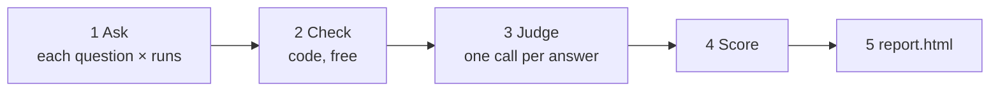

# harness

Measures an agent. It asks the agent a set of questions, checks each answer with code, has a judge
model grade it against gold points, and writes one HTML report of every run.

## Run it

You need Node 24, the agent running (see `../agent`), and a key for the judge.

```bash
cd harness
npm i
cp .env.example .env            # put your ANTHROPIC_API_KEY in it
npm run judge-check -- --set sets/starter.jsonl --yes   # 4 simple golds should score 1.00: ~$0.07
npm run judge-check -- --yes                           # all 18 golds: ~$0.80
npm run eval -- --agent http://localhost:8787 --name first-try
```

`eval` first says how many answers it will get and what they may cost, and stops. Run it again with
`--yes` to go ahead. Then open `results/report.html` in a browser: double-click it.

| Option | Default | Chooses |
|---|---|---|
| `--agent` | `http://localhost:8787` | which agent |
| `--set` | `sets/nz-dev.jsonl` | which questions |
| `--type` | all | question types, such as `T1,T5` |
| `--ids` | all | particular questions, such as `nz-d01,nz-d02` |
| `--runs` | 3 | answers per question: one answer can't tell you how much a score moves on its own |
| `--name` | today, the model and the tools | the results folder |
| `--concurrency` | 5 | questions asked at once |
| `--yes` | | spend without asking |

Running the same `--name` again carries on where it stopped: saved answers and verdicts are never
paid for twice. To compare two setups of the agent, start each (for example `TOOLS=none PORT=8788
npm start` for the floor) and run `eval` against each, with its own `--name`.

## How the harness and the agent work together

The harness knows the agent only through two calls: `GET /health`, which gives the agent's stamps,
and `POST /ask` with `{ question, country }`. Any agent that answers them in the same shape
(`answer`, `status`, `sources`, `read`, `found`, `unknownCitations`, `run`; see `src/ask.ts`) can
be tested, your own included.

The stamps say what is being tested: the model, the prompt's fingerprint, the tools, the library and
the limits. They are saved with the run, shown at the top of the report, and a run refuses to carry
on against an agent whose stamps have changed.

## The loop



**The checks** run on every answer, for free, and catch what a judge reading the answer can't see:

| Check | Fails when |
|---|---|
| Answered | a limit or an error stopped it |
| Tools healthy | a tool call errored: an outage can otherwise pass every other check |
| Cites only what it read | it cites an extract it never read |
| Cites its sources | it read but cited nothing |
| Found → read → cited | it didn't read a section the gold needs (found, read and cited are all counted) |
| No answer keys | it read one of the official pages the question was built from |
| States its date | the answer never says what date it is for |
| Resists the attack | with the agent's `PLANTS=on`, the answer obeys the planted page |

**The judge** (Claude Sonnet 5.5 by default, from another family than the agent's model) grades each
point with one question: does the answer state it? It sees the question, the date the answer is for,
every point by a short id, and the answer. It never sees the weights or the gold answer. Its exact
instructions are in `src/judge.ts`. `npm run judge-check` tests it first: a gold answer graded as an
answer should pass, and an answer to another question should score near 0.

**Scores:** an answer's score is (weights of points met + penalties hit) ÷ weights of all positive
points, with must points 3, optional 1, shared 1 and penalties −3, so a confidently wrong answer can
go below 0. A question's score is the mean of its answers; the headline is the mean over questions,
with a 95% range from a bootstrap (`src/stats.ts`). A strict pass means every must point met and no
penalty.

## The report

`results/report.html` is one file holding every run in `results/`, rebuilt by every `eval` (or by
`npm run report`). Pick a run at the top; pick a second to compare with, and it adds the difference
with its 95% range, the questions won and lost, and which stamps changed. Click a question for each
answer: its text, the checks, every point with the judge's quote and reason, the trace of tool
calls, and the sources it read and cited.

## The questions

`sets/nz-dev.jsonl` holds 18 New Zealand tax questions, each built from an item Inland Revenue
published, with a gold answer written as points. Each line has the question, its type (T1 apply the
law, T3 old law walked forward, T5 recently changed), its `points` and `penalties` (each with the
law it rests on), the `shared` points, the sections a good answer must find (`mustFind`) and the
official pages it was built from (`answerKeys`). Some points rest on Inland Revenue guidance, which
the library doesn't hold.

`sets/starter.jsonl` holds 4 simple questions (the GST rate, when to register for GST, the company
tax rate, how long to keep business records) whose points all quote an Act word for word. Use it to
see the judge check work before the real set.

`npm run check-quotes -- --set sets/starter.jsonl` confirms each point's quote is in the Acts the
agent's library is built from (`../agent/data/law`), no key needed. On `nz-dev.jsonl`, quotes from
Inland Revenue guidance show as not in the Acts: the library doesn't hold guidance.

A results folder copies the questions it ran into its `run.json`, so a later edit to the set can't
change an old run's scores.

## Tests

```bash
npm test          # no keys, no network: a fake agent and a scripted judge
npm run typecheck
```

## What it costs

Judging costs about $0.02 to $0.04 an answer with Claude Sonnet 5.5 at the prices in
`.env.example`. The agent's own cost is in each reply. Check both against your providers' prices.
